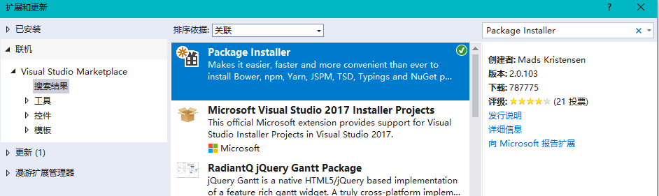
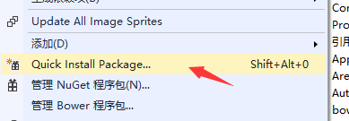
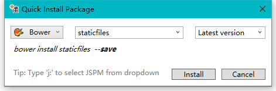

**English** | [简体中文](quickstart.md)

# Architecture overview

## Frontend technologies

> The frontend primarily uses jQuery-EasyUI-insdep 2.0 with additional JavaScript extensions. It is based on EasyUI 1.5.2 and does not support IE9 or earlier. Libraries are generally under bower_components; because some have been removed from the project, source downloads are linked below. Refer to each project's official documentation for details.

* JQuery-EasyUI-insdep 2.0  [Source download](https://pan.baidu.com/s/1U8qu8DCP19aQY0hudkiXOA)、
[Official website](https://www.insdep.com/) Project files have custom changes and should not be upgraded without review.
* jquery-extensions　[Source download](https://pan.baidu.com/s/1EDYwfHgGcQEA6S5N8-j_jg) This extension is unmaintained and its original repository is no longer available. It is based on EasyUI 1.3.6. Do not reference its published minified bundle directly in this project; reference the extensions in bower_components\jquery-extensions\jeasyui-extensions individually in dependency order. Some bugs have been fixed, and some extensions may be removed because newer EasyUI versions include them.
* jquery.jdirk.js adds common JavaScript methods required by extensions-master; the full code is in extensions-master.[Documentation](http://223.2.193.104:11) 
* cropper avatar upload, cropping, rotation, and related features; blueimp-canvas-to-blob addresses compatibility in some browsers
* Editor: a lightweight web rich-text editor that is easy to configure and use. Supports IE10+. [wangeditor3](https://www.kancloud.cn/wangfupeng/wangeditor3/332599)
* File uploads [webuploader](http://fex.baidu.com/webuploader/)  Supports IE6+, Android 4+, and iOS 6+. The project-specific staticfile/libs/abp.wbeuploader.js extension should not be upgraded without review. See File/Index.cshtml for multiple-file upload and File/ImageView.cshtml for multiple-image upload with preview.

## Frontend maintenance
The project uses Bower to manage frontend libraries; staticfiles contains shared JavaScript.
 * Repository: https://github.com/luoyunchong/staticfiles.git
 * Bower static resource address http://223.2.193.15:5678/
 * The staticfiles README contains developer notes describing its features.

>Create a .bowerrc file in the root directory to configure a custom Bower repository.

~~~
{
    "registry": "http://223.2.193.15:5678",
    "timeout": 30000
}
~~~

> Run the following command in the web project directory:

~~~
    bower install staticfiles --save
~~~
Alternatively, use Extensions and Updates (Package Installer).

Right-click the web project  

Enter staticfiles 

Click Install to install the staticfiles JavaScript package from 223.2.193.13. The folder contains:
* easyui.default-extension.jsadds default EasyUI properties and jQuery extensions
* base.js the com object shared by most projects
* passwordComplexityHelper.js allows credential rules to be configured in the backend
* libs contains shared JavaScript from ABP. abp.jquery.js has been modified, and abp.easyui.js and abp.layer.js provide a common interface for different dialog styles.
